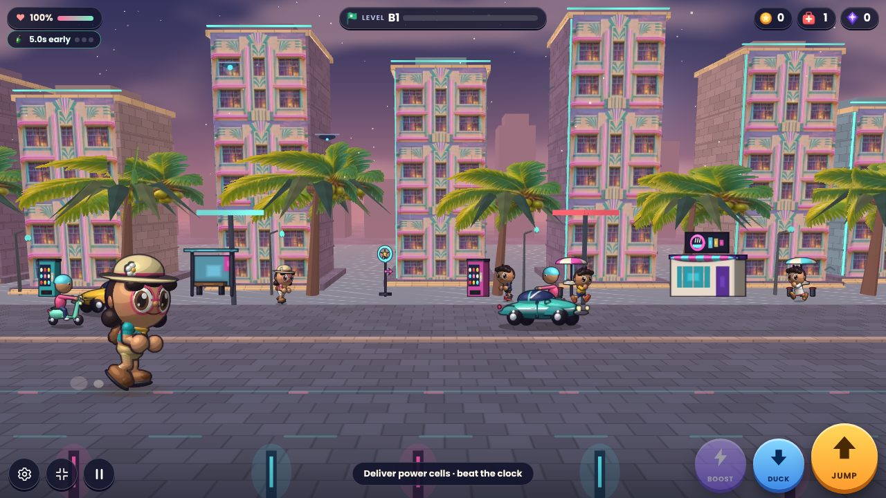
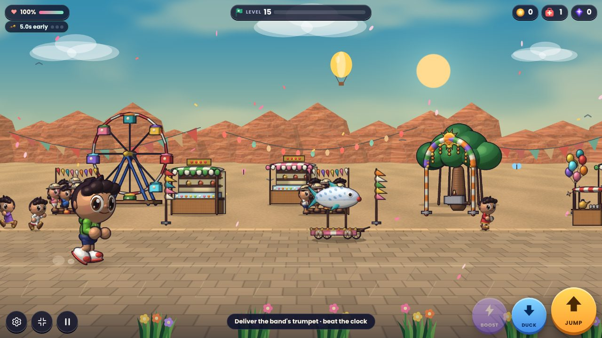
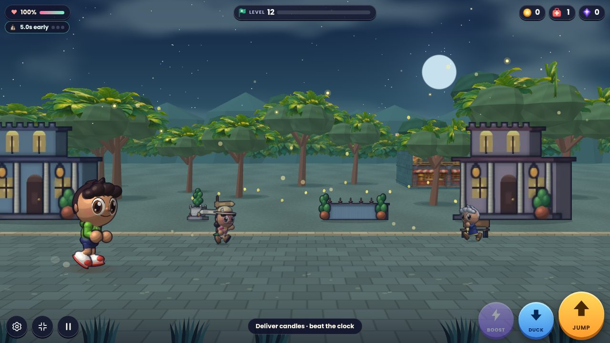
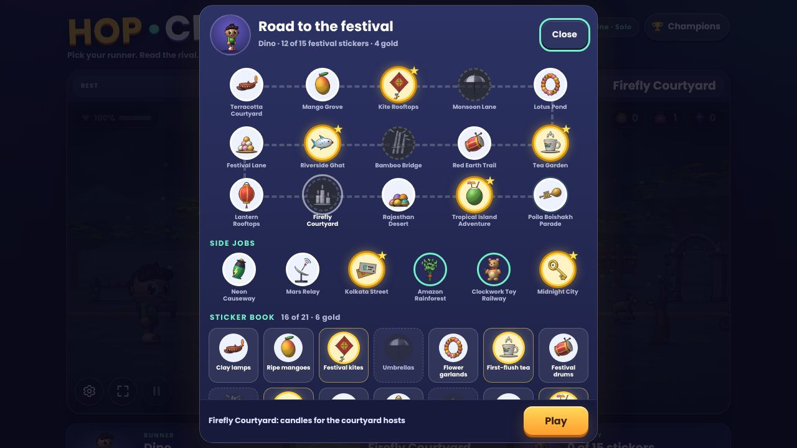

# Hop Crew

A side-on runner for phones and desktop. Read the rival, time the jump, make it to the finish.
It runs offline from a single HTML file, with no server and no accounts.



| | | |
| --- | --- | --- |
|  |  |  |

## Play

- **In a browser:** open `index.html` (the welcome page) and press Play now, or open `play.html` directly.
- **On a phone:** open the published page in Chrome and choose "Add to Home screen" to install it.
- **Inside another app:** load `play.html` in a web view. It needs nothing else next to it.

Controls: Jump (tap the scene, Space or Up), Duck (hold, Down or S), Boost (B) when the cue turns green, Esc to pause.

## Runners

| Runner | Notes |
| --- | --- |
| Boy | Four outfits: Street, Festival, Explorer, Sport |
| Girl | Explorer with hat and glasses, four shirts: Tropical, Stripes, Starry, Sunset |
| Dino | Four looks: Original, Red scarf, Blue cap, Shades |
| Tinku | Wind-up robot: Classic, Red scarf, Royal cape |
| Pixel Kid | Hero. Turns golden on Boost |
| Elephant Calf | Hero. Mega trumpet on Boost |
| Terracotta Horse, Little Ghost, Golden Hatchling | Secret. Each hidden treasure you find unlocks the next one |

Four colours apply to every runner except the Golden Hatchling.

## How a path plays

- **Rivals** announce their move on a banner: Jump, Double jump or Duck. Ground rivals mix their moves from run to run.
- **Traps and surprises** give no banner, only a small tell: leaf pits, vine snares and swinging logs in the jungle; carts, dogs, balls and kite strings in towns.
- **The red dino** is the boss near the finish of every path except Neon Causeway and Mars Relay. Duck its flame, then double jump.
- **Clean run**: every six clean passes raise the score multiplier by a quarter, up to double. Any hit resets it.
- **Revives**: two per path. The first costs 20 points, the second 60, and you return with 70% vitality.
- **Final stretch**: the last third of a path speeds up.
- **Tutorial**: a new player gets a short playable lesson. "How to play" on the start card replays it.

## Sound, opening and results (v18)

- `src/js/sound.js`: all audio is generated in the browser, no recordings. A stereo mix with a room and a left/right echo, seven music themes picked by path type (village, jungle, city, desert, mars, toy, night), layers that join as the run goes on, a tense layer near the red dino, and a wide finish fanfare.
- `src/js/film.js`: the opening ("Tap to play", then an eight second film that can be skipped or switched off under Runner & sound) and the results board (one to three stars plus run counts).
- Stars: 1 for finishing, 2 for two hits or fewer with no revive, 3 for also dodging or beating the red dino (or zero hits on paths without it).

- Star charm (v19): a clay pot that glints by the road on roughly half the runs, at a random spot. Run through it on the ground to collect it; it beats the red dino outright when he shows up.
- Bonus paths have their own music: Neon Causeway (synthwave), Mars Relay (space radio), Kolkata Street (tabla, reed and tram bell), Amazon Rainforest (mallets and birds), Clockwork Toy Railway (music box and train), Midnight City (brushes and a clock-tower bell).
- Tapping "Tap to play" also switches to fullscreen, and to landscape on phones that allow it.

## Story (v21)

- `src/js/story.js`: every path is a delivery for tonight's festival. A short scene hands over the parcel before the run, and a payoff scene hands it on at the finish. Scenes can be skipped, or switched off under Runner & sound.
- Delivery clock: starts 5 seconds early. A hit costs 2 s, a revive 3 s; a rival beaten wins 1 s and a trap dodged 0.5 s. Finish with time in hand to earn the path's sticker. A late delivery still unlocks the next path.
- Three hidden items per path. All three plus an on-time delivery makes the sticker gold.
- Delivery streak: each on-time delivery in a row adds 50 bonus points (up to 250). Being caught or arriving late resets it.
- Journey map: the Journey button shows the road to the festival with a sticker at every stop, plus the six side jobs (bonus paths).
- The last path ends with the parade, which shows every delivery that made it on time.
- Scenes use front-view portraits baked by `tools/bake/bake5.py` (sprites named `front_*.webp`).
- All of the numbers above are constants at the top of `story.js`.

## Art pass (v22)

- `tools/bake/bake6.py` draws the townsfolk of the story scenes (`npc_*.webp`), the toon cobra and anaconda, the golden hatchling, and the sharp close-up strips: `front_*.webp` (front view) and `close_*.webp` (side view), used whenever a runner is shown large.
- The red dino, tiger, cat, langur and ape sheets are baked at double their old size for the zoomed moments.
- The girl's four shirts each have their own base colour.
- The opening film fills whatever box it gets and letterboxes inside the picture, so it fits upright, rotated and fullscreen phones.

## Rivals and home screen (v23 to v28)

- Every rival is now a baked toon sheet from `tools/bake/bake6.py`: sentinel, relay stalker, boar, croc, eagle, kite, owl, bat, crab, cobra and anaconda join the red dino, tiger, cat, langur and ape. The old 3D rival meshes are no longer drawn.
- Little Ghost is rebuilt, and the bat has skin wings.
- The home screen has a Journey card with the player's avatar and sticker count. The map shows the avatar and a sticker book of all 21 stickers. The avatar wears a crown once all 15 festival stickers are earned, with sparkles when all are gold.
- Story scenes draw every pose from the sharp close-up strips: the runner hops in instead of running, and the townsfolk strips are baked at 768 pixel cells.

## v29

- Side-event crowds and helpers, the jaguar, the ray, the neon interceptor and Pixel Kid are all baked toon sheets now (`bake6.py`: `CROWD`, `pixel`, `ray`, `car`, and the `jaguar` palette in `bake4.py`).
- The opening film uses double-size sheets for its three runners (`film_*.webp`) and the sharp close-up strips on the title.
- The "Neon Causeway" shortcut and the "25-minute tour" button are hidden (`game.css`); their code is still there.
- Sticker pack: once all 15 festival stickers are earned, the sticker book offers a download (`hop-crew-stickers.zip`: one 512 pixel PNG per earned sticker, the crowned avatar, and `stickers.json`) and, where the browser supports it, a share sheet for the pictures. Since v37 the sticker pictures are the game's own drawings, so the pack looks the same on every device.

## Obstacles and Neon Causeway (v33)

- `tools/bake/bake7.py` draws every road obstacle as a toon prop, in a normal and a tall form (35 types, `props.webp`). It prints the tile tables, which live in `src/js/play.js` after the `/*@@PROP@@*/` and `/*@@STREET@@*/` markers; paste the new tables there after re-baking. Obstacle sizes in play are unchanged.
- The Neon Causeway pile-up uses three different wrecks (`pursuit_wreck.webp`).
- Neon Causeway has street life (`neonLife` in `play.js`). Every person, vehicle and building has a true depth, ground speed and size (`neonCast`, `neonSize`) and is projected through the scenery camera (`viewPoint`), so it scales, scrolls and stands on the ground as the 3D street does, including during the opening camera move. Each lane has one speed, so nothing overlaps. In `buildWorld`, zone 12 keeps its far lane (z 5 to 11) and pavement (z 11 to 14) clear: the 3D cars are removed there, and the palms, lamps and buildings are set back.

## Path life on every path (v35)

- All 21 paths now have life drawn by the same rules as Neon Causeway (`neonLife`, `lifePlan`, `lifeBands` in `play.js`): a true depth, one speed per lane, a real size, the scenery camera, back to front.
- On the other 20 paths the life keeps to the open ground between the running lane and the first scenery, so it is always in front of the 3D world. The depth bands in `lifeBands` come from scanning each world for scenery at people height; if a world's layout changes, re-scan before moving a band.
- New sprites: cow, goat, dog, camel, duck, rickshaw, ox cart and rover (`bake6.py`, four-frame strips `street_*.webp`), and village furniture in `bake7.py` (bench, tea stall, haystack, signpost, tent, flag pole, well, fruit cart).
- The pile-up wrecks have flat dents and scratches; their smoke is drawn live in `streetHazard`.

## Scenery, side trails and stickers (v36, v37)

- v36: street riders (cycle, scooter, rickshaw, ox cart) have the same toon proportions as walkers. The Midnight City crew and their car are toon sheets.
- Four thin paths have a far row of large toon set pieces behind the path life (`tools/bake/bake8.py`, `scene.webp`, table after `/*@@SCENE@@*/` in `play.js`, sizes in `sceneSize`): Red Earth Trail (huts, terracotta temple, Bankura horse, pot racks), Firefly Courtyard (lit house, gate, tulsi altar, lamps, cot, wall), Rajasthan Desert (tents, resting camels, water pots, fort gate) and the Parade (spectator stands, festival gates, sweet stall, balloons). A far row is the sixth entry of a `lifePlan` line. The 3D scenery of those four worlds starts behind that row.
- The Parade has a moving procession: owl, tiger and fish floats roll one way at one speed (`street_float*.webp`).
- The ten side trails have path life too (`lifePlan` zones 21 to 30).
- Every delivery has its own drawn picture (`tools/bake/bake9.py`, `items.webp`, 7 by 3 tiles in path order). It is used for stickers, hidden parcels, the delivery chip, the journey map, the sticker book and the sticker pack. No sticker uses an emoji.
- Removed: the old 3D character meshes and the old hand-drawn rival fallbacks. Every rival is a sheet.
- The two world textures were re-saved at a lower quality setting to shrink the file.

## Sharpness and scenery on every path (v38)

- The play picture is drawn at the screen's own density up to a pixel budget (`gfxSteps` in `cast.js`). If a device cannot keep a smooth pace the budget steps down and is remembered (`hop-crew-gfx` in local storage); each new visit tries one step sharper again.
- Runner sheets are 768x504 cells (`BAKE_SS=6 BAKE_OUT=3 BAKE_Q=82 python3 tools/bake/bake6.py src/assets/sprites sheet boy/street ...`).
- Every main path has a far row of toon set pieces (`bake8.py`: trees, boats, shop fronts, rooftop pieces, a fairground wheel, Mars habitat and more). `WORLD_STAGE` in `cast.js` moves each world's 3D scenery back to open clear ground for that row; the test script checks nothing 3D stands in front of it.
- On dark paths the path life is drawn on its own layer and tinted with the night colour (`lifeNight` in `play.js`).

## Tests

```
pip install playwright
python3 tools/tests/check.py            # add --shots to refresh docs/screenshots
```

It opens the built `play.html` offline in headless Chrome and checks that every path, side trail, rival and runner draws, that path life never overlaps and stays in front of the 3D scenery, and that the sticker pack builds.

## Project layout

```
index.html              welcome page with the Play button (hand-written, uses docs/screenshots)
play.html               built game, one self-contained file
manifest.webmanifest    install details for "Add to Home screen"
sw.js                   offline cache for the installed copy
icons/                  app icons
src/
  index.template.html   page markup
  css/game.css          all styles
  js/game.js            rules, HUD, settings, scene life
  js/play.js            boss, traps, surprises, multiplier, tutorial, rival gallery (included by game.js)
  js/cast.js            3D world, rival and obstacle drawing, sprite sheet list, start-up
  js/film.js            opening film and results board (included by game.js)
  js/story.js           deliveries, stickers, scenes, journey map (included by game.js)
  js/sound.js           music and sound effects (included by game.js)
  assets/sprites/       character sheets (4x4 frames of 256x168)
  assets/world/         scenery textures
tools/
  build.py              packs src/ into play.html
  bake/                 scripts that draw the character sheets, props, scenery and stickers
  tests/check.py        automated checks
docs/screenshots/       pictures used in this README
LICENSE                 MIT
TERMS.txt               what it is, privacy and terms
```

## Build

```
python3 tools/build.py
```

This inlines the styles, scripts and images from `src/` into `play.html`. Edit files in `src/`, never `play.html`. `index.html` is the welcome page and is edited by hand.
When you publish a new build, bump `VERSION` in `sw.js` so installed copies pick it up.

## Drawing characters

The sheets in `src/assets/sprites/` come from `tools/bake/`. They need Python with `numpy`, `scipy` and `Pillow`.
`bake4.py` is the current entry point; it reuses the rigs in `bake.py`, `bake2.py` and `bake3.py`.

```
cd tools/bake
# runners, 768x504 cells
BAKE_SS=6 BAKE_OUT=3 BAKE_Q=82 python3 bake6.py ../../src/assets/sprites sheet boy/street girl/tropic dino/plain bot/classic pixel/plain calf horse ghost hatch
# rivals and roadside characters, 256x168 cells
python3 bake4.py ../../src/assets/sprites red tower tiger cat ape langur
```

Files are written as `<kind>_<outfit>.webp`. Single-look characters use the short name in the game, so rename after baking:
`calf_plain` to `calf`, and the same for `horse`, `ghost`, `hatch`, `red`, `cat`, `tower`, `tiger`, `langur`, `ape`.

Runner sheets use this frame order: 0 to 9 run, 10 and 11 idle, 12 jump, 13 and 14 cheer, 15 slide.
Roadside characters and rivals use: 0 to 11 run, 12 to 15 action.
Anything painted pure "runner green" in a sheet is recoloured by the colour picker in the game.

## Publish on GitHub Pages

Step by step, including installing on a phone and making an APK: see `docs/PUBLISH.md`.

1. Push this folder to a repository.
2. In the repository settings, open Pages and choose "Deploy from a branch", branch `main`, folder `/ (root)`.
3. The game appears at `https://<user>.github.io/<repository>/`.

## Status

Version 39. Saves from earlier versions load and are migrated (the game was called Dino Bluster before v18; the save key is unchanged on purpose).
Created by Atanu Sarkar. Made with Claude. Licence: MIT (see `LICENSE`). Terms and privacy: see `TERMS.txt`.
The results board carries a small dedication, "From R".
